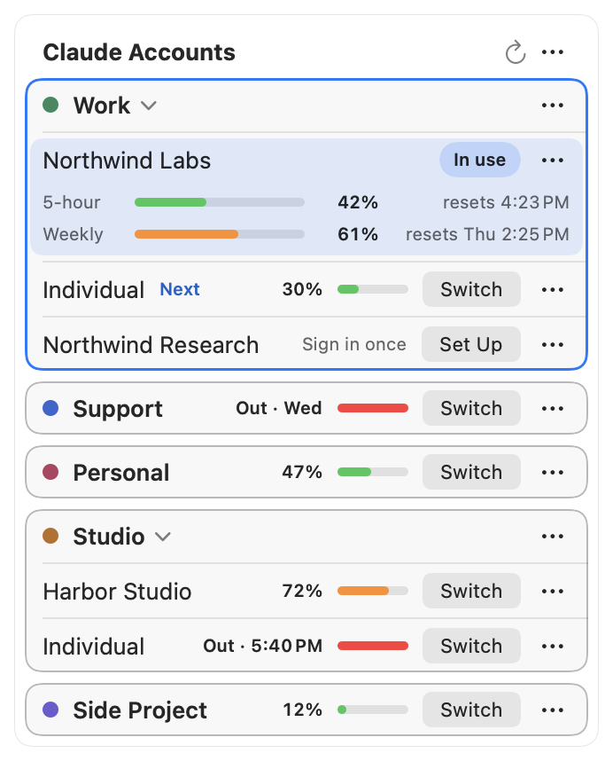

# ClaudeAccounts

**Switch Claude accounts without losing your chats.**

[](https://github.com/RohanNaga/ClaudeAccounts/releases/latest)
[](https://github.com/RohanNaga/ClaudeAccounts/releases/latest)
[](https://github.com/RohanNaga/homebrew-tap)
[](LICENSE)

A macOS menu bar app for people with more than one Claude seat: a work plan, a
team, a personal plan. A seat is one Claude account in one organization, and
each seat is one row in the menu. The app does three things:

1. It shows each seat and how much usage it has left: the 5-hour and weekly
   limits, with their reset times.
2. It switches the Claude desktop app to a seat when you click **Switch**, and
   your open Claude Code chats move with it: same history, same worktrees.
3. It switches by itself when the seat in use is truly out, then sends each
   chat that was stopped one "resume" message.

<p align="center">
  
</p>

> ClaudeAccounts is an independent project. It is not made, endorsed or
> supported by Anthropic. Claude is a trademark of Anthropic. Use each account
> under Anthropic's terms for that account.

## Install

```bash
brew install --cask rohannaga/tap/claudeaccounts
```

Or download `ClaudeAccounts-<version>.zip` from the
[latest release](https://github.com/RohanNaga/ClaudeAccounts/releases/latest),
unzip it, and move **Claude Accounts** to Applications.

You also need the Claude desktop app, and Claude Code installed at
`~/.local/bin/claude`: each seat's meters are read through its own Claude Code
sign-in. The app runs on macOS 15 or later.

The app isn't notarized by Apple, so macOS stops the first launch with "Apple
could not verify Claude Accounts is free of malware". Open **System Settings ›
Privacy & Security**, scroll down, and click **Open Anyway**. If you'd rather
use Terminal:

```bash
xattr -dr com.apple.quarantine "/Applications/Claude Accounts.app"
```

## Getting started

Before there are any rows, the menu says what the app reads and keeps, and asks
you to open Claude and sign in.

1. Open Claude and sign in. A minute later the seat Claude is on becomes the
   first row. When Claude is later on a seat that isn't a row, the menu says so
   and offers **Add**.
2. **Add Account…** in the menu's `···` signs a seat in to Claude Code for its
   meters. Your browser opens Claude's sign-in page; paste the code it shows
   back into the app. A row whose meters have no sign-in has **Sign in
   again…** in its `···` menu.
3. A row with no saved Claude login reads "Sign in once" and has **Set Up**.
   Set Up quits Claude and reopens it at its sign-in page. Sign in as that seat.
   Once Claude has stayed on it for a minute, the app saves its login, and from
   then on Switch moves to it.
4. For the automatic switch, click **Allow…** in the menu and turn on
   **Claude Accounts** under System Settings › Privacy & Security ›
   Accessibility. It answers Claude's quit prompt and types "resume" with it.

## How a switch works

Switch, Set Up and the automatic switch all run one procedure. Each step is
written to a journal before it runs, so an interrupted switch can be finished
or undone. The menu's one notice line says which step is running.

**Switch** works on every seat that is signed in, whatever it reads: out on
either meter, not read yet, stale, skipped after a failed automatic switch, in
the 15 minutes after an automatic switch, and with Auto-Switch off. Only a
seat that needs signing in shows **Set Up** instead. The automatic switch
never moves Claude off a seat you chose for anything from before your choice:
a chat Claude stopped earlier no longer counts. If Claude then stops a chat on
the seat you chose because that seat is out, the app moves Claude on, as after
any other stop.

1. **Quit.** The app asks Claude to quit and watches its process and windows
   ("Quitting Claude…"). If a chat is mid-reply, Claude asks first. A switch you
   started waits for your answer. **Cancel** ends it with "Switch cancelled."
   and nothing changed. When a switch you started ends with Claude still on its
   seat, cancelled or failed, the automatic switch doesn't ask Claude to quit
   again until Claude reopens or Auto-Switch is turned off and on.
2. **Back up and save.** It backs up Claude's cookie database and settings
   file. If Claude stayed on the current seat for a minute, by the app's clock
   or by Claude's own log, it saves that seat's login ("Saving <seat>…"). A login is written to a new file, checked,
   then renamed over the old one, and the previous copy is kept until the new
   one checks out.
3. **Move chats.** Each open chat's record moves from the current seat's folder
   to the target's, so its session id, transcript and worktree stay the same.
   Archived chats and scheduled runs stay with their seat.
4. **Load.** It loads the target's saved login ("Loading <seat>…"). Set Up
   clears the sign-in instead, so Claude asks for one.
5. **Launch and confirm.** It reopens Claude and waits up to 3 minutes (10 for
   Set Up) for Claude's log to name the target and stay on it for a minute
   ("Waiting for Claude to open as <seat>…"). Only lines Claude logs after
   that launch count, found by their place in the log, never by the time they
   print. Then the notice reads "Switched to <seat>." and the chats are resumed.

If Claude names another seat, asks for a new sign-in, or doesn't open in time,
the switch rolls back: Claude quits, the chats move back, the previous login is
loaded, and Claude reopens. The notice says why and ends "Back on <seat>." If
you close Claude during the wait, the notice reads "Open Claude to finish
switching to <seat>." If the app or the Mac stops mid-switch, the next launch
reads the journal. A switch stopped before its load step is undone, and one
stopped after it is finished. Only one switch runs at a time.

Each switch leaves a folder in `backups` with the files from before it and
`switch.json` listing what moved. The last ten are kept.

## Automatic switching

The automatic switch acts only on what is true now, read again every few
seconds from Claude's log and the seat readings. It counts only what Claude
logged since it last opened on the seat it is on, or was switched to it, by
the app, by you, or by a sign-in inside Claude. Nothing from before that counts.
It also counts only lines it saw arrive while it was running, timed by its own
clock: a stop already in the log when the app starts never switches or types,
and nothing the app stores can quit Claude, switch or type.

A seat is out only when a reading from the last 15 minutes shows its 5-hour or
weekly meter at 100 percent, until that meter's own reset. The app switches
when Claude, a minute or more after it opened on the seat in use, stopped a
chat there for a usage limit, and that seat read 100 percent no more than 15
minutes after the stop and still does. The usage service can report room for a
few minutes after a real limit, hence the 15 minutes. A turn that ends normally
on the seat after a stop shows Claude still serves it, so that stop no longer
counts. The app reads the seat a minute after a stop, then every 5 minutes,
so in practice a stop counts when the seat first reads 100 within 10 to 15
minutes of it. When the seat in use reads 100 percent and no chat is stopped,
or the stop came before the app started, nothing is quit: the row says "Out"
with that meter's reset beside **In use**, the notice says "In use reads 100%.
It switches when Claude stops a chat.", and the switch comes when Claude stops a
chat. A stop on a seat that reads with room never starts a switch either:
Claude can stop a chat for a limit the seat's meters don't show, and the seat
then stays as it reads. After an automatic switch, whether it worked or not,
the next one waits at least 15 minutes, and a chat stopped meanwhile waits too. The notice says when, as
in "Switching to Research at 3:25 PM.", and a relaunch of the app keeps the 15
minutes.

Claude's log prints local times with no time zone. The app never sets one
against its own clock: it uses them only to tell how long Claude held a seat
before a later line. Moving between time zones, daylight saving, or a Mac
asleep for hours changes nothing it decides. When Claude's log is rotated or
cut short, the app reads on from where it was, so it loses no line it saw and
counts none twice. At launch it reads back through the rotated logs to the
line that names the seat Claude is on, however long Claude has run.

If an automatic switch fails and Claude reopens on the seat it left, nothing
retries by itself, since Claude reopening starts over. The notice reads
"Didn't switch to Research. Switch by hand.", the full sentence on hover and the
notification say it tries again when Claude next stops a chat, 15 minutes after
the failed switch began at the earliest. The line stays until that stop, when it
says when the switch goes. If Claude doesn't quit, nothing changes and
the app asks Claude to quit only once: it doesn't try again, or try another
seat, until Claude reopens, you switch by hand, or Auto-Switch is turned off
and on. The notice reads the same line, and its full sentence on hover and the
notification say why and that it won't try again.

It goes down the menu from the seat in use, wrapping round to the top, and
picks the first seat that is ready, has a reading from the last 15 minutes, and
hasn't failed a switch in the last 10 minutes. **Move Up** and **Move Down** in
a row's `···` menu set that order. **Switch Order** in the menu's `···` can
instead try every **Individual** seat first (**Personal First**) or every
organization seat first (**Organizations First**), each in menu order. The menu
marks the seat it would go to with **Next**; when that seat's account is folded
away, the mark is on the account's name. Because nobody is there to answer Claude's
quit prompt, the automatic switch presses **Quit anyway** itself. It looks for
the button again at every look, however late the prompt shows or slowly
Accessibility answers. While a prompt is up that it can't press, the notice
reads "Answer Claude: Quit anyway to switch, Cancel to stay.", and after 10
seconds one notification says the same. If Claude still hasn't quit after 3
minutes, it cancels and changes nothing; when it can't find the prompt to
cancel, the full sentence on hover says the prompt is still open, until Claude
quits or reopens.
If Claude shows no prompt and hasn't quit after 90 seconds, it stops there.

When every other seat reads out or still needs setting up, it stays put, and
the notice says which seat resets first. With more than one seat, one
notification says so too, once per wait, also across Auto-Switch turned off
and on. At the first reading of the seat in use with room, the wait is over:
each chat still stopped for it gets "resume" once, in place, and a chat that
ran meanwhile is left alone. A seat not read yet is never counted as out: the
app reads it, then decides. If the usage service stops answering during a
wait, the notice stays as it was until a new reading ends the wait. If Claude
closes or moves to another seat, or the app is quit, the wait is over, and
nothing from it is typed or switched later: only Claude's next stop switches.

It pauses itself, with one line in the menu saying why:

- **Auto-Switch When Out** in the menu's `···` is off. It is on from the start.
- Accessibility isn't allowed. macOS ties that permission to the app's
  signature, so a new version may need it again.
- Something the app expects from Claude is missing at run time: Claude reopens
  without its log naming a seat within the confirm wait, the quit prompt has no
  **Quit anyway** button, or Claude's cookie database is in a format the app
  doesn't know. The line reads "Switching on its own is paused." with the
  reason, and switching turns back on by itself once that changes. The app
  never looks at Claude's version, so an update that changes none of these
  changes nothing. **Switch** by hand keeps working when the log line or the
  button is missing, because it needs only quit, launch and that one log line,
  and it rolls back if the line never comes. An unknown cookie format stops it
  too, before anything changes.

The app posts notifications only for automatic switches: one that succeeded or
failed, a quit prompt it can't press, and every seat being out. One automatic
switch posts at most two.

## After the switch

Once Claude confirms the new seat, each moved chat the switch is for gets one
new message, "resume": after an automatic switch, the chats stopped for the
limit that started it and those cut off by the quit; after a switch by hand,
every chat Claude stopped for a limit since it last opened, and those cut off
by the quit. The app opens the chat with a `claude://code/continue` link, checks
through Accessibility that Claude's window shows that chat, puts "resume" in
its message box and presses Send, once. It skips a chat that is running, a
chat whose message box holds a draft, and a chat it has already resumed. It
never presses Retry, Rewind, Stop or Keep working.

A chat that doesn't start is tried again every minute for 30 minutes, and only
after a minute with nobody using the Mac. After that the menu names the chats
that need a message from you. Each step is written to `resume.log` in the app's
folder. If the app is quit mid-resume, the chats it hadn't reached stay as they
are: the next launch types nothing.

## What it cannot guarantee

- **Claude can change its log, files or window in an update.** Automatic
  switching and resume pause, manual Switch keeps working where its few needs
  hold, and one line says so. If Claude's cookie format changes, every switch
  stops before it changes anything, until the format is one the app knows.
- **The meters come from an undocumented usage service.** If it fails or
  changes, the meters aren't read, the automatic switch has no target, and
  manual Switch still works.
- **Claude may refuse a saved login at any time**, for a sign-in that is too
  old or a change on its side. The switch rolls back, and the row asks you to
  sign in once more, across relaunches, until you do. A refusal Claude logged
  while the app wasn't running marks no saved login, but while it is Claude's
  last word on that seat, the automatic switch never goes there. Its row still
  shows Switch, and a switch you start runs at once.
- **Typing "resume" depends on Claude's window and on Accessibility.** If
  either fails, the app names the chats that need a message.
- **Usage credits.** A seat at 100 percent with credits still available reads
  out on its row and is never a target, though Claude would still serve it. On
  the seat in use nothing switches, since Claude keeps going and stops no chat.
- **A crash of the Mac itself mid-switch.** The journal finishes or undoes the
  switch at the next launch.

## Privacy

Nothing the app keeps leaves the Mac. It has no analytics and no update check.

### Network

- **Usage service.** The app's only network request of its own is
  `GET https://api.anthropic.com/api/oauth/usage`, made with each seat's Claude
  Code token: every 5 minutes, a minute after each reset, and at most once a
  minute after a turn ends. An HTTP 429 answer waits as long as the service
  asks, or 5 minutes.
- **Token renewal.** When a seat's token has under 10 minutes left, the app
  runs `claude -p /usage --no-session-persistence` for that seat, and Claude
  Code renews the token itself. This spends no model usage.
- **Sign-in and removal, only when you click.** **Add Account…** and **Sign in
  again…** run `claude auth login --claudeai` and open Claude's sign-in page in
  your browser. **Remove…** runs `claude auth logout` for that seat.

The `claude://` links that open chats and the link to System Settings stay on
the Mac. Claude itself, which the app quits and reopens, makes its own
connections as usual.

### On the Mac

| Where | What | When |
|---|---|---|
| `~/Library/Application Support/ClaudeAccounts` | Everything the app keeps: `accounts.json`, settings, each seat's Claude Code login folder, saved Claude logins, meter readings, the switch journal, backups, `resume.log`, and `diagnostics.jsonl` | Always |
| `diagnostics.jsonl` | One line per change of Claude's state, a seat's state or the automatic decision, each switch's start and end, each limit stop as it arrives (whether Claude had held the seat a minute), and each new run of the seat in use's readings (full or not, and since when), with times, state names and row numbers only; and while a switch waits for Claude to quit, each look at Claude's windows that differs from the last or takes a second or more, with its time in milliseconds, window roles and button titles. No names, emails, ids, tokens, window titles or chat content. It rotates at 4 MB | Always |
| Login keychain | One `Claude Code-credentials-<hash>` item per seat, written by Claude Code. The app reads its token for the usage service | Always |
| `~/Library/Application Support/Claude` | The claude.ai cookie rows, three keys in `config.json`, and chat records in `claude-code-sessions` | Written only during a switch, with Claude quit. Read to save the seat in use's login once Claude has stayed on it for a minute |
| `~/Library/Logs/Claude/main.log` | Read only: which seat Claude is on and since when, refused sign-ins, chats stopped at a limit, and turns that ended | Always |
| Claude's windows, through Accessibility | The quit prompt's **Quit anyway** button, and each chat's message box and Send button | During an automatic switch, and when resuming chats |

**Remove…** in a row's `···` menu deletes its saved login, signs its Claude Code
login out and deletes its keychain item. Its chats stay in Claude. To
uninstall, remove your rows, quit the app, and delete it and the
`~/Library/Application Support/ClaudeAccounts` folder.

## The menu

The title bar and one notice line stay in place, and the rows scroll. The menu
is never taller than the screen, and it opens on the seat in use.

- A ready seat is one line: its name, the fuller meter with its percent, and
  **Switch**. An out seat says "Out" with its reset time in place of the meter.
  Click the name to see both meters.
- The seat in use shows both meters with their resets. When it is out, it also
  says "Out" with its reset time beside **In use**.
- **Next** marks the seat the automatic switch would go to.
- An account in several organizations, like a personal plan and a team, is one
  card with a row per organization. Its own personal organization shows as
  **Individual**. Click the account's name to fold its organizations away.
- A row's `···` menu has **Rename…** (rename to an empty name, or **Reset
  Name**, to go back), **Color**, **Move Up**, **Move Down**, **Sign in
  again…** and **Remove…**.
- The title's `···` menu has **Add Account…**, **Menu Bar Shows**, **Gauge
  Tracks** (5-hour or weekly limit), **Auto-Switch When Out**, **Switch Order**,
  **Open at Login** and **Quit Claude Accounts**.

## Command line

The binary is at `Claude Accounts.app/Contents/MacOS/ClaudeAccounts`.

| Command | What it does |
|---|---|
| `--status` | Prints Claude's state, whether Accessibility is granted, whether automatic switching is on, each row's state by its label, and the automatic decision. It reads the same facts as the menu and changes nothing |
| `--test-resume <title or id>` | Sends "resume" to that one open chat by the steps a switch takes after it reopens Claude, once, and prints each step. Use a chat you don't mind getting it |

`--test-resume` needs Accessibility. To use the app's own access rather than
your terminal's, start it through the app:

```sh
open -n -W -o "$(tty)" --stderr "$(tty)" -a "/Applications/Claude Accounts.app" --args --test-resume "<chat title>"
```

## Build from source

```bash
git clone https://github.com/RohanNaga/ClaudeAccounts.git
cd ClaudeAccounts
./build.sh
open "Claude Accounts.app"
```

It needs the Xcode Command Line Tools (`xcode-select --install`). `build.sh`
compiles one binary for Apple Silicon and Intel with `swiftc`, then signs and
checks it before it replaces this folder's copy, so a build that fails, or that
would lose the installed copy's Accessibility permission, changes nothing. If
this folder's copy is running, `build.sh` quits it, swaps the new one in and
opens it, and puts the old one back if the new one does not start; it never
touches a copy elsewhere.

macOS ties the Accessibility permission to the app's signature, and the ad-hoc
signature `build.sh` uses by default changes with every build, so each rebuild
asks for the permission again. To keep it across builds, run
`scripts/make-signing-identity.sh` once to add a local signing identity to your
login keychain; `build.sh` signs with it from then on.

`test.sh` runs the rule checks in `tests/`, then drives the quit prompt code
against a real native alert and the resume step against a stand-in chat window.
Those flash small windows for a moment and need Accessibility for your
terminal. `release.sh` builds and zips the app into `dist/` for a GitHub
release and prints the checksum the Homebrew cask needs. The icon is drawn by
`app/make-icon.swift`; delete `app/AppIcon.icns` to regenerate it.
`scripts/render-menu.sh` draws the menu in fixed states to PNGs without
starting the app; its `menu-readme.png` is `docs/menu.png`.

Before 0.3 the app kept its state in a `data` folder beside itself. A launch
that finds one moves it to Application Support and carries each login's
keychain item over.

## License

MIT. See [LICENSE](LICENSE).
